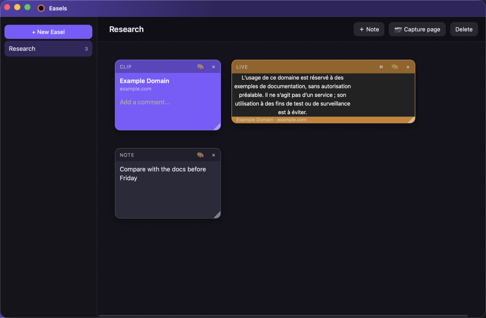
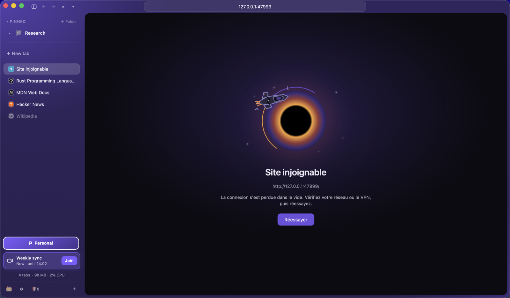

<div align="center">


### Un navigateur rapide, élégant et respectueux de votre vie privée.

Écrit en Rust, BlackHole s'appuie sur le moteur web natif de votre système :<br>
WebKit sur macOS, WebView2 sur Windows, WebView sur Android.


[**⬇️ Télécharger**](../../releases) · [Nouveautés](#-nouveautés-088) · [Fonctionnalités](#-fonctionnalités) · [Vie privée](#-vie-privée) · [Extensions](#-extensions) · [Développement](#-développement)

<br>


</div>

<br>

## ✨ En bref

|   |   |
|---|---|
| 🗂️ **Organisé** | Barre latérale à la Arc, espaces colorés, dossiers et onglets épinglés qui gardent leur adresse. |
| ⚡ **Rapide et léger** | Moteur natif, quatre onglets vivants par défaut, voisins préchargés, anciens libérés. |
| 🛡️ **Privé par défaut** | Shields intégrés, HTTPS automatique, liens nettoyés, aucune télémétrie, aucun compte. |
| ⌨️ **Au clavier** | Une seule barre de commandes pour les onglets, l'historique, l'Easel, les téléchargements et plus. |
| 📲 **Multi-appareils** | macOS, Windows et Android, synchronisés sur le réseau local, sans serveur. |

---

## 🆕 Nouveautés 0.8.8

- 🔎 **Une seule recherche** — la barre de commandes trouve aussi les surlignages, zones surveillées, onglets fermés, téléchargements et, avec Recall, les pages lues.
- 🖼️ **L'Easel rassemble tout** — tableau du comparateur, avant/après d'une zone surveillée, texte reçu d'un autre appareil ; une carte en direct peut prévenir quand sa zone change.
- 📤 **Envoyer partout** — un lien, une page, un surlignage ou un fichier part vers votre autre appareil depuis n'importe quel menu.
- 🗒️ **Cartes qui durent** — ce qui s'est passé en votre absence reste dans la barre latérale jusqu'à ce que vous y répondiez.
- 🔍 **Zoom mémorisé** par site, et la carte d'un appel quitte vraiment l'appel quand on la ferme.

Le détail de chaque version s'affiche sur la page d'accueil après une mise à jour.

<details>
<summary>📜 <b>Versions précédentes</b></summary>

- 📌 **0.8.7** — onglets épinglés avec leur propre adresse, dossiers à la Arc, menu contextuel BlackHole sur toutes les pages, nouvelle animation de lancement.
- 🧠 **0.8.6** — Recall (retrouver une page lue à partir de quelques mots), onglets trou noir, vue scindée pilote, liens nettoyés, surlignages, Wormhole.
- 🚀 **0.8.5** — blocage des traqueurs par le moteur lui-même, plus léger sur YouTube, Google Docs et Meet.
- 📲 **0.8.4** — BlackHole pour Android se met à jour seul, barre d'adresse modifiable, recherche dans la page, site bureau.
- 📱 **0.8.0** — BlackHole pour Android et synchronisation des onglets entre appareils appairés.

</details>

---

## 🖼️ Aperçu

| Page d'accueil | Nouveautés après mise à jour |
|:---:|:---:|
|  |  |
| **Easel avec une zone en direct** | **Page d'erreur** |
|  |  |

<p align="center"></p>

---

## ✨ Fonctionnalités

### 🧭 Navigation

- 🗂️ **Barre latérale à la Arc** avec des **espaces** colorés pour cloisonner vos contextes, chacun avec ses propres cookies (perso et pro côte à côte).
- 📌 **Onglets épinglés et dossiers** qui gardent leur adresse d'origine et y reviennent au réveil.
- ◧ **Vue scindée**, avec un mode pilote où les liens d'un panneau s'ouvrent dans l'autre, et **aperçu flottant** d'un lien (`Maj + clic`).
- 🕳️ **Onglets trou noir** : session isolée, rien dans l'historique, détruite à la fermeture.
- 🪟 **Glisser un onglet** vers une autre fenêtre, ou l'**envoyer** sur un autre appareil.

### 🧰 Productivité

- ⌨️ **Barre de commandes** (`Ctrl/Cmd + L`) : onglets, historique, surlignages, téléchargements, actions — tout au clavier.
- 🎨 **Easel** : tableaux de notes et de captures de pages, y compris des zones **en direct** et **surveillées**.
- 🧠 **Recall** (optionnel) : retrouvez une page lue à partir de quelques mots, texte chiffré sur l'appareil.
- 🖍️ **Surlignages** persistants avec notes, et **Bibliothèque** réunissant médias, téléchargements, historique et archives.
- 📅 **Google Agenda et Meet** : prochaine réunion dans la barre latérale, notes dans un Easel à côté de l'appel.
- 💅 **Boosts** : CSS personnalisé par site.

### 📺 Média et appareils

- 🎵 **Mini-lecteur** dans la barre latérale (lecture, son, micro et caméra d'un appel) et **Picture in Picture** automatique avec retour à l'onglet.
- 🌀 **Wormhole** : texte, presse-papiers ou fichier envoyés à un appareil appairé, chiffrés, sans serveur.
- 🔁 **Synchronisation** des onglets, de l'accès rapide et des espaces entre ordinateurs et téléphone.

### ⚡ Performances et finitions

- 🧠 **Léger en mémoire** : quatre onglets vivants par défaut (réglable), voisins préchargés, anciens mis en veille.
- 🚀 **Démarrage rapide** : chargement parallèle, écritures disque en arrière-plan.
- ✨ **Animations soignées**, désactivables, et respect de `prefers-reduced-motion`.
- 🌍 **Interface en français et en anglais**, changement de langue instantané.

<details>
<summary>⌨️ <b>Raccourcis clavier</b></summary>

| Action | Raccourci |
|---|---|
| Barre de commandes | `Ctrl/Cmd + L` |
| Onglet précédent | `Ctrl + Tab` |
| Parcourir la barre latérale | `Ctrl/Cmd + Alt + ↑ / ↓` |
| Rouvrir le dernier onglet fermé | `Ctrl/Cmd + Maj + T` |
| Fermer (ou mettre en veille un onglet épinglé) | `Ctrl/Cmd + W` |
| Recall | `Ctrl/Cmd + Maj + F` |
| Aperçu d'un lien | `Maj + clic` |
| Outils de développement | `F12`, `Ctrl + Maj + I` (`Cmd + Option + I` sur macOS) |

</details>

---

## 🔒 Vie privée

- 🚫 **Aucune télémétrie.** Moteur de recherche **DuckDuckGo** par défaut ; Brave Search, Startpage, Qwant, Mojeek ou Google au choix.
- 🛡️ **Shields** : traqueurs, publicités, emplacements pub, pubs YouTube et bannières cookies bloqués par le moteur lui-même, avec un rapport de confidentialité par site.
- 🔗 **HTTPS automatique** et **liens nettoyés** : paramètres de suivi supprimés, redirections des moteurs et réseaux sociaux contournées.
- 🔑 **Mots de passe** dans un coffre chiffré (ChaCha20-Poly1305), clé dans le trousseau système, proposés uniquement sur le bon site.
- 📥 **Import** depuis Chrome, Edge, Brave, Vivaldi, Opera, Firefox et dérivés (favoris, mots de passe via export CSV).

---

## 🧩 Extensions

De **vraies WebExtensions**, installables en un clic depuis **Réglages → Extensions** : uBlock Origin Lite, Dark Reader, SponsorBlock, Bitwarden. Chaque paquet provient de sa release officielle et est vérifié par **SHA-256 épinglé**.

|   | macOS | Windows |
|---|---|---|
| Moteur | WKWebView | WebView2 (Chromium) |
| Extensions | `WKWebExtensionController` (15.4+) | `AddBrowserExtension` |
| Limites | Pas de Touch ID ni de messagerie native | Ni badge ni onglet actif |

Sous macOS, les extensions Safari des apps installées peuvent aussi être activées — voir [docs/macos.md](docs/macos.md).

---

## 📦 Installation

Les versions sont publiées dans les [**releases GitHub**](../../releases).

| Plateforme | Paquet |
|---|---|
| 🪟 **Windows** | `BlackHole-Setup-X.Y.Z-x64.exe` ou zip portable |
| 🍎 **macOS** | `.dmg` : glisser `BlackHole.app` dans `/Applications` |
| 🤖 **Android** | `BlackHole-android.apk` |

BlackHole se met à jour lui-même : un bouton apparaît dans la barre latérale quand une nouvelle version existe, et chaque téléchargement est vérifié par SHA-256.

---

## 🛠️ Développement

Architecture en couches : `domain` → `application` → `infrastructure` → `app` (winit + wry). Les règles du dépôt sont dans [`AGENTS.md`](AGENTS.md) et [`.github/copilot-instructions.md`](.github/copilot-instructions.md) ; le design system dans [`docs/design-system/`](docs/design-system/).

```bash
cargo run -p blackhole             # développement
cargo run --release -p blackhole   # performances maximales
cargo clippy --workspace --all-targets
cargo test --workspace
```

<details>
<summary>🧪 <b>Tests d'interface</b> (feature <code>devtools</code>)</summary>

- **Windows** : `scripts\test-ui.ps1`, `scripts\test-ext.ps1`, `scripts\test-easel.ps1`
- **macOS** : `scripts/test-webext.sh`, `scripts/test-easel.sh`, `scripts/test-errors.sh`, `scripts/test-popup.sh`, `scripts/test-settings.sh`, `scripts/test-i18n.sh`
- Les captures de ce README se régénèrent avec `scripts/readme-shots.sh`.

</details>

<details>
<summary>🤖 <b>Android</b></summary>

Version allégée : coque Kotlin dans `android/` et cœur Rust dans `crates/android`.

```powershell
cd android; .\gradlew.bat assembleDebug
scripts\test-android.ps1   # émulateur ou appareil USB
```

Outils et détails : [docs/android.md](docs/android.md).

</details>

<details>
<summary>🚢 <b>Installeur Windows et publication</b></summary>

```powershell
cargo build --release -p blackhole
iscc /DAppVersion=X.Y.Z /DExePath=..\target\release\blackhole.exe scripts\windows-installer.iss
```

Pour publier : mettre à jour `version` dans `Cargo.toml`, committer et pousser sur `main` (ou pousser le tag `vX.Y.Z`). `release.yml` teste, construit les installeurs et publie avec `SHA256SUMS.txt`.

</details>

---

## 🗺️ Feuille de route

- Fenêtre flottante compacte
- Notarisation macOS

---

<div align="center">

Fait avec ❤️ et 🦀 Rust · Licence MIT

</div>
