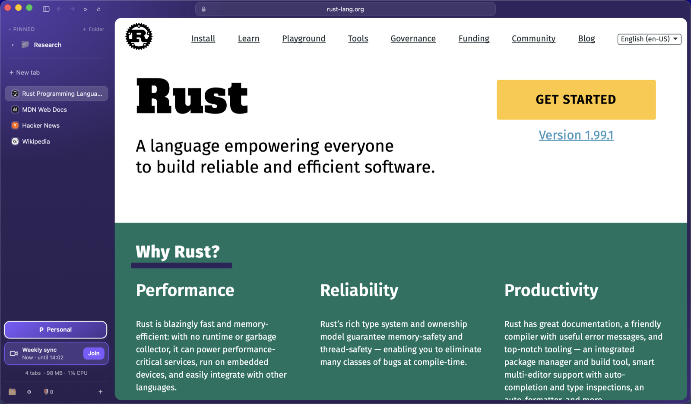
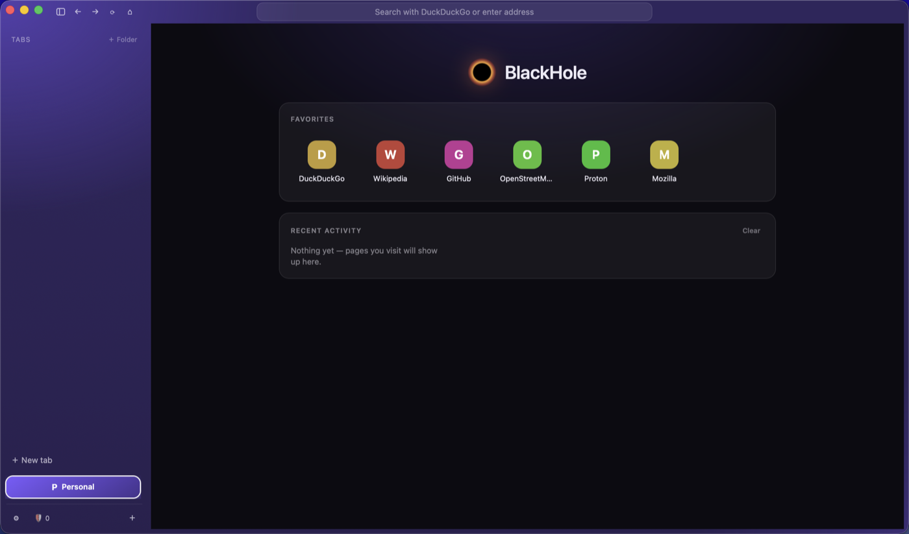
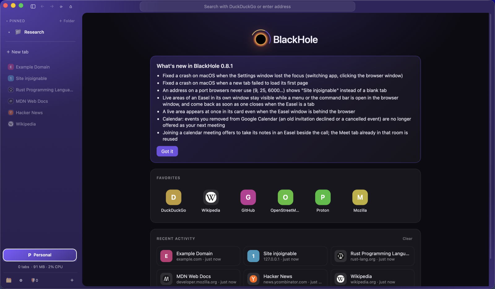
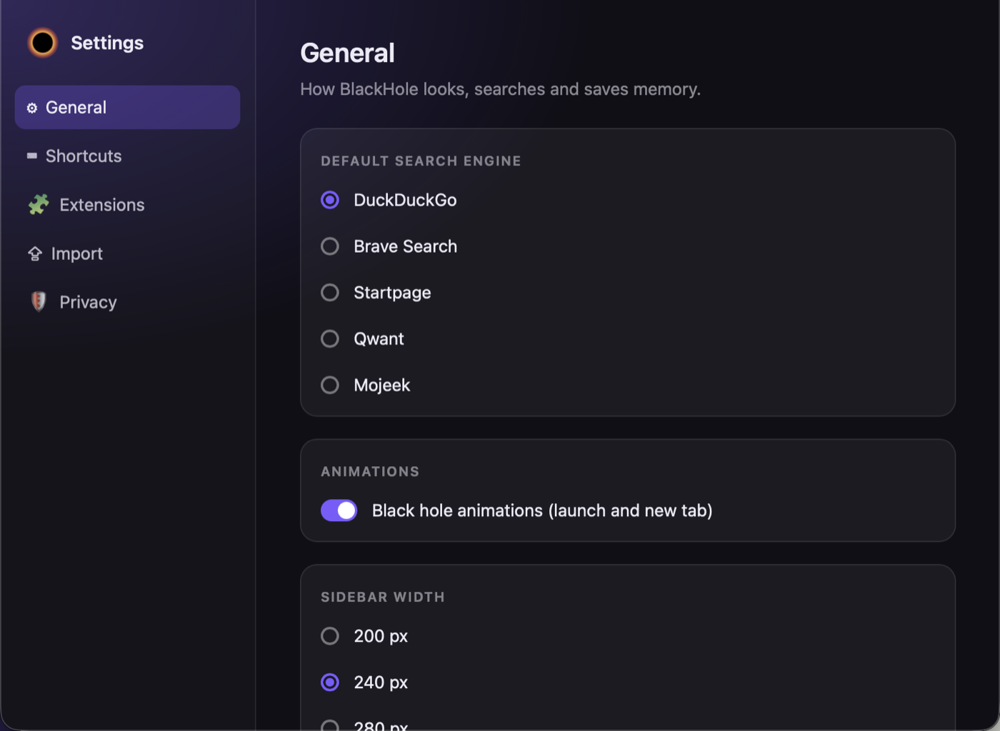

<div align="center">

# 🕳️ BlackHole

**Un navigateur rapide, élégant et respectueux de votre vie privée.**
Écrit en Rust, il s'appuie sur le moteur web natif de votre système : WebKit sur macOS, WebView2 sur Windows.


[Fonctionnalités](#-fonctionnalités) · [Installation](#-installation) · [Extensions](#-extensions) · [Vie privée](#-vie-privée) · [Développement](#-développement)



</div>

---

## 🖼️ Aperçu

| Page d'accueil | Nouveautés après mise à jour |
|---|---|
|  |  |



## ✨ Fonctionnalités

- 🗂️ **Barre latérale à la Arc** et 🌌 **espaces** colorés pour cloisonner vos contextes.
- 🧠 **Léger en mémoire** : peu d'onglets vivants (4 par défaut, réglable), voisins préchargés, anciens libérés.
- ⌨️ **Barre de commandes** (`Ctrl/Cmd + L`) : tout se fait au clavier, avec recherche dans tout l'historique.
- 🔁 **Onglets à la Arc** : nouveaux onglets en haut de la liste, `Ctrl + Tab` revient à l'onglet précédent, `Ctrl/Cmd + Alt + ↑/↓` parcourt la barre latérale, `Ctrl/Cmd + Maj + T` rouvre le dernier onglet fermé ; `Ctrl/Cmd + W` sur un onglet épinglé ou de dossier le met en veille sans le retirer.
- ◧ **Vue scindée** et 👀 **aperçu** flottant d'un lien (`Maj + clic`).
- 🎨 **Boosts** : CSS personnalisé par site.
- 🖼️ **Easel** : tableaux de notes et de captures de pages, y compris en direct.
- 📚 **Bibliothèque** : médias, téléchargements, historique et onglets archivés au même endroit.
- 🔐 **Comptes par espace** : chaque espace a ses propres cookies (perso et pro côte à côte).
- 📺 **Média** : mini-lecteur dans la barre latérale (lecture, son, micro et caméra d'un appel), Picture in Picture automatique (changement d'onglet ou perte de focus) avec retour à l'onglet.
- 🪟 **Glisser un onglet** vers une autre fenêtre pour l'y déplacer.
- ⚡ **Démarrage et navigation rapides** : chargement parallèle, écritures disque en arrière-plan.
- ✨ **Animations soignées** : la liste d'onglets se réorganise en douceur, changement d'espace glissé, barre d'adresse et accueil animés (désactivables dans les réglages ; `prefers-reduced-motion` respecté).

| | macOS | Windows |
|---|---|---|
| Moteur | WKWebView | WebView2 (Chromium) |
| Extensions | `WKWebExtensionController` (15.4+) | `AddBrowserExtension` |
| Installation | `BlackHole.app` / `.dmg` | Installeur et zip portable |
| Mise à jour | Remplacement du `.app` | Installeur silencieux |

---

## 📦 Installation

Les versions sont publiées dans les [releases GitHub](../../releases).

- **Windows** : lancez `BlackHole-Setup-X.Y.Z-x64.exe` (ou le zip portable).
- **macOS** : ouvrez le `.dmg` et glissez `BlackHole.app` dans `/Applications` (ou `scripts/package-macos.sh --install`).

Un bouton « Update to vX.Y.Z » apparaît dans la barre latérale quand une version existe ; le téléchargement est vérifié par SHA-256.

---

## 🧩 Extensions

De **vraies WebExtensions**, installables en un clic depuis **Paramètres → Extensions** : uBlock Origin Lite, Dark Reader, SponsorBlock, Bitwarden. Chaque paquet vient de sa release officielle et est vérifié par **SHA-256 épinglé**.

Limites : pas de Touch ID ni de messagerie native sous macOS ; sous Windows, WebView2 n'expose ni badge ni onglet actif.

Sous macOS, les extensions Safari des apps installées peuvent aussi être activées (détails : [docs/macos.md](docs/macos.md)).

---

## 🔒 Vie privée

- Moteur **DuckDuckGo** par défaut, **aucune télémétrie**.
- Blocage des traqueurs (liste dans `crates/infrastructure/blocklist.txt`), HTTPS automatique, paramètres de suivi supprimés.
- Mots de passe importés dans un **coffre chiffré** (ChaCha20-Poly1305), clé dans le trousseau système.
- `unsafe` interdit hors des crates d'intégration système (`macos-url`, `macos-webext`).

**Import** : Paramètres → Import détecte Chrome, Edge, Brave, Vivaldi, Opera, Firefox et dérivés (favoris, mots de passe via export CSV).

---

## 🛠️ Développement

Architecture en couches : `domain` → `application` → `infrastructure` → `app` (winit + wry). Détails dans `.github/copilot-instructions.md`.

```bash
cargo run -p blackhole             # développement
cargo run --release -p blackhole   # performances maximales
cargo clippy --workspace --all-targets
cargo test --workspace
```

**Tests d'interface** (feature `devtools`) : `scripts\test-ui.ps1`, `scripts\test-ext.ps1`, `scripts\test-easel.ps1` (Windows) ; `scripts/test-webext.sh`, `scripts/test-easel.sh` (macOS).

**Android** (version allégée, coque Kotlin + cœur Rust `crates/android`) : `cd android; .\gradlew.bat assembleDebug`, puis `scripts\test-android.ps1` (émulateur ou appareil USB). Outils et détails : [docs/android.md](docs/android.md).

**Installeur Windows** :
```powershell
cargo build --release -p blackhole
iscc /DAppVersion=X.Y.Z /DExePath=..\target\release\blackhole.exe scripts\windows-installer.iss
```

**Publier** : mettre à jour `version` dans `Cargo.toml`, committer et pousser sur `main` (ou pousser le tag `vX.Y.Z`). `release.yml` teste, construit les installeurs et publie avec `SHA256SUMS.txt`.

---

## 🗺️ Roadmap
- Blocage réseau natif (`WKContentRuleList` sur macOS, interception WebView2 sur Windows)
- Fenêtre flottante compacte
- Notarisation macOS

---

<div align="center">Fait avec ❤️ et Rust</div>
