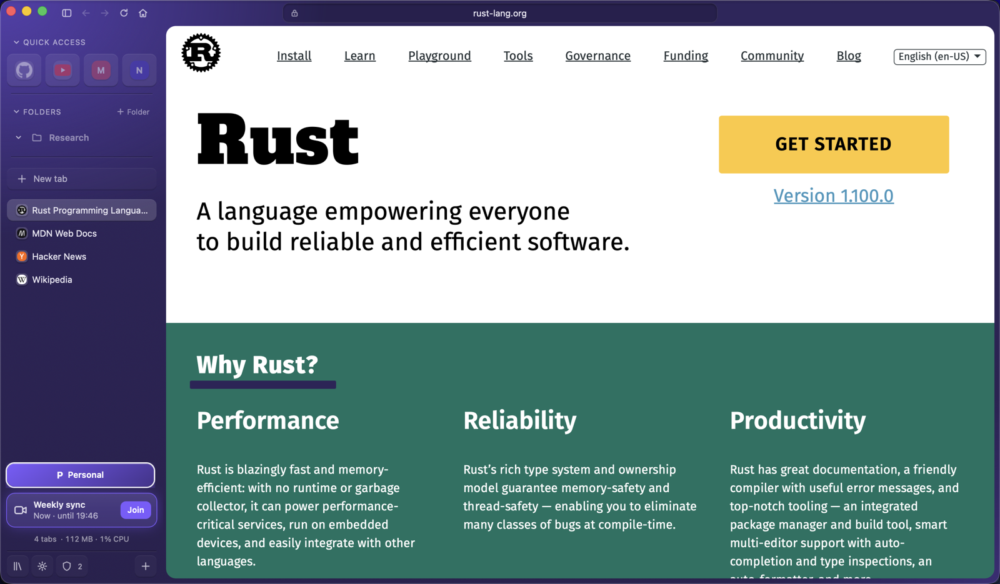
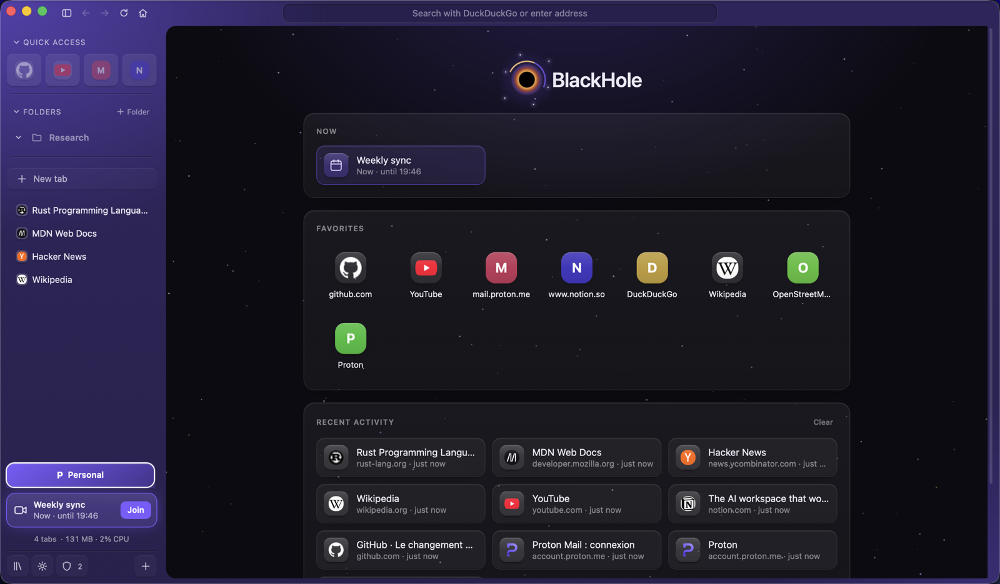
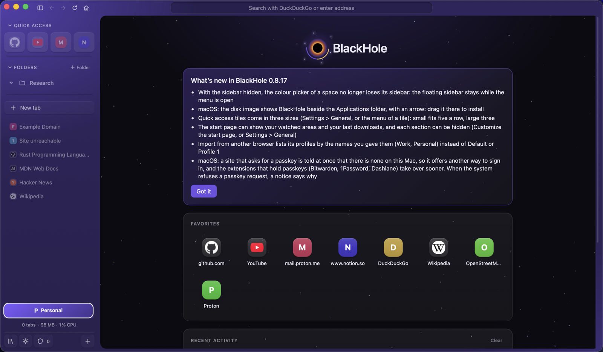
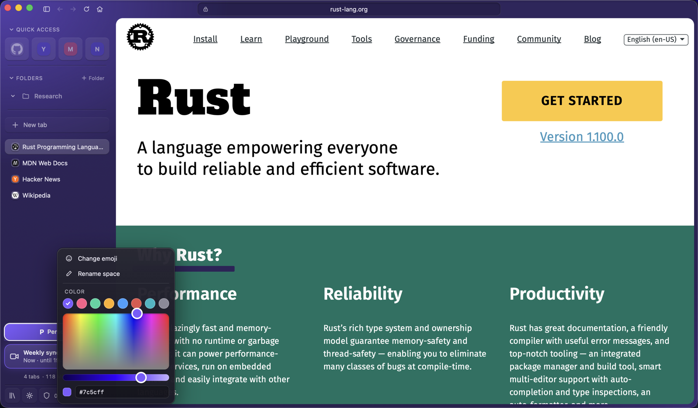
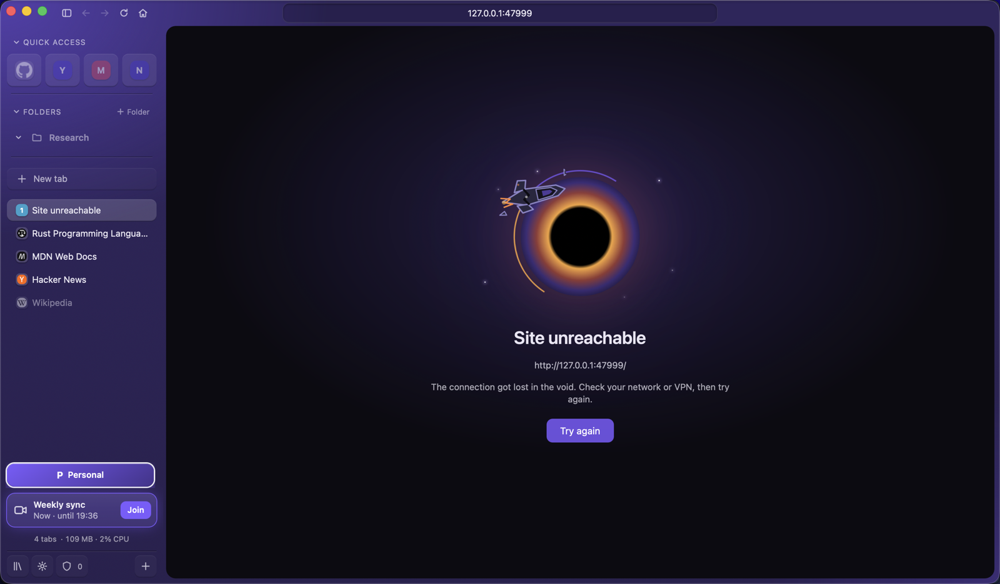
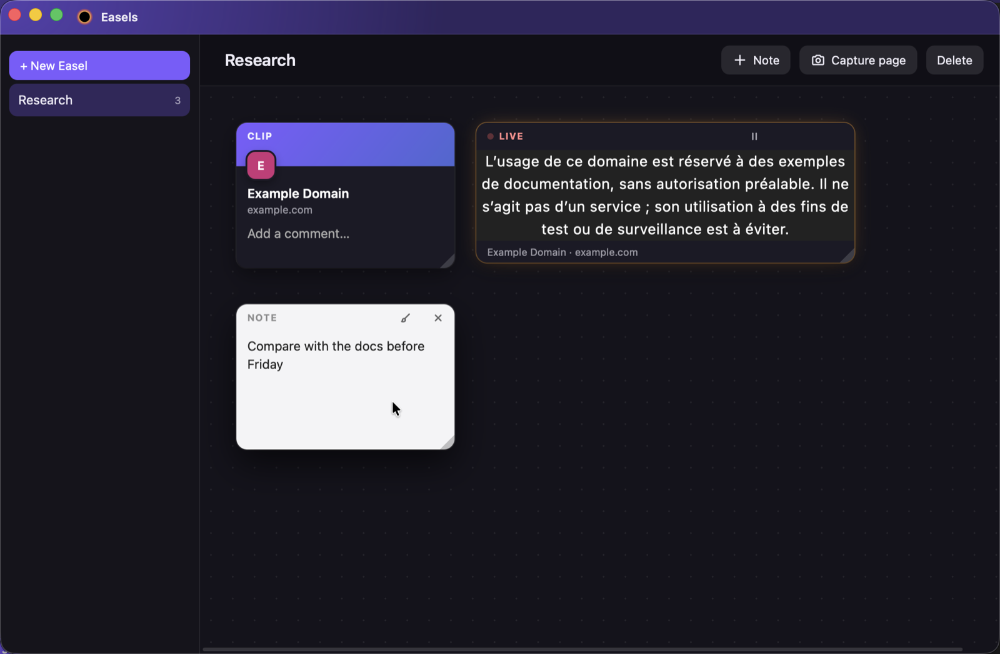
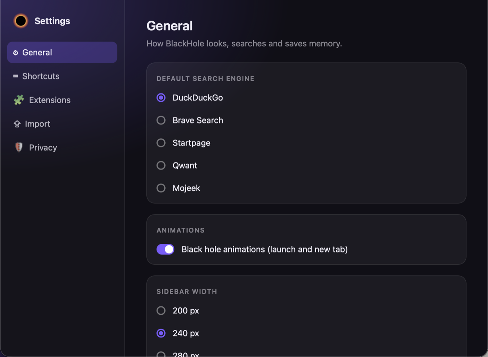

<div align="center">


### Un navigateur rapide, élégant et respectueux de votre vie privée.

Écrit en Rust, BlackHole s'appuie sur le moteur web natif de votre système :<br>
WebKit sur macOS et Linux, WebView2 sur Windows, WebView sur Android.


-FCC624?logo=linux&logoColor=black)


[**⬇️ Télécharger**](../../releases) · [Nouveautés](#-nouveautés-0824) · [Fonctionnalités](#-fonctionnalités) · [Vie privée](#-vie-privée) · [Extensions](#-extensions) · [Développement](#-développement)

<br>



</div>

<br>

## ✨ En bref

|   |   |
|---|---|
| 🗂️ **Organisé** | Barre latérale à la Arc, espaces colorés, dossiers et onglets épinglés qui gardent leur adresse. |
| ⚡ **Rapide et léger** | Moteur natif, quatre onglets vivants par défaut, voisins préchargés, anciens libérés. |
| 🛡️ **Privé par défaut** | Shields intégrés, HTTPS automatique, liens nettoyés, aucune télémétrie, aucun compte. |
| ⌨️ **Au clavier** | Une seule barre de commandes pour les onglets, l'historique, l'Easel, les téléchargements et plus. |
| 📲 **Multi-appareils** | macOS, Windows et Android (Linux en aperçu), synchronisés sur le réseau local, sans serveur. |

---

## 🆕 Nouveautés 0.8.24

- 🫥 **Protection contre l'empreinte numérique** — ce que les sites lisent pour reconnaître votre appareil (canvas, WebGL, audio, carte graphique, nombre de cœurs) change d'un site à l'autre et à chaque lancement. Activée par défaut, désactivable dans Réglages › Confidentialité › Shields.
- 🔐 **DNS chiffré** — les noms des sites visités partent chiffrés vers Quad9, Mullvad, Cloudflare, AdGuard ou le résolveur de votre choix. Windows : le moteur de BlackHole, au prochain lancement ; macOS : un profil système à installer.
- 🐧 **Mise à jour depuis l'app sous Linux** — le paquet `.deb` (avec le mot de passe administrateur) comme l'archive.
- 📞 **Grosses visioconférences plus légères** — plus de PiP forcé sur un appel que l'on écoute, une surveillance des médias allégée, une carte de réunion plus sobre et, sous Windows, un appel laissé en arrière-plan garde sa mémoire.

Le détail de chaque version s'affiche sur la page d'accueil après une mise à jour.

<details>
<summary>📜 <b>Versions précédentes</b></summary>

- 🕳️ **0.8.23** — une visite au premier lancement (import, navigateur par défaut, extensions, couleur du premier espace), style plat pour un nouveau profil, BlackHole choisissable comme navigateur par défaut sous Windows.

- 🪟 **0.8.22** — la fenêtre se déplace de nouveau sous Windows, fenêtres privées plus calmes, nouvelle fenêtre plus rapide.

- 🐙 **0.8.21** — ajouter une extension depuis son dépôt GitHub, vérifiée contre l'empreinte publiée, marquée « Non vérifiée ».

- 🧩 **0.8.20** — market d'extensions (recherche, catégories, fiche détaillée avec empreinte et permissions), accord demandé quand une mise à jour ajoute des permissions, Réglages plus larges.

- 🧩 **0.8.19** — catalogue d'extensions signé, rafraîchi chaque jour depuis GitHub sans attendre une version de BlackHole, jamais de retour à une version plus ancienne.

- 🔎 **0.8.18** — recherche bien plus juste dans la barre de commandes, historique partagé entre appareils, rechargement forcé, moins de « Site injoignable » fantômes, accueil réorganisable, Réglages dans la page.

- 🏠 **0.8.17** — tuiles d'accès rapide en trois tailles, accueil à la carte (zones surveillées, téléchargements), clés d'accès macOS, profils d'import nommés, image disque macOS à glisser.
- 🐧 **0.8.16** — Linux en aperçu (`.deb` et archive), couleur libre pour chaque espace, inspecteur web ancré dans la page, style 3D sans inclinaison.
- 🧩 **0.8.15** — extensions Windows qui voient de nouveau la bonne page, fin des pages blanches de l'extension anti-bannières.
- ⚓ **0.8.14** — onglets ancrés jamais mis en veille, traqueurs appris en naviguant, gestionnaire de mots de passe désactivable.
- ↩️ **0.8.13** — Annuler après une suppression, navigation entre onglets au clavier, recherche dans la page à travers les liens.
- 🧊 **0.8.11 – 0.8.12** — styles 3D et plat, nouvelles cartes de l'Easel, vue scindée animée, site de présentation.
- 🔔 **0.8.9 – 0.8.10** — notices visibles même barre latérale masquée, téléchargements lancés depuis une page, zones surveillées vers l'Easel de votre choix.
- 🔎 **0.8.8** — une seule recherche pour tout, l'Easel qui rassemble tout, envoi vers un autre appareil depuis n'importe quel menu.
- 📌 **0.8.7** — onglets épinglés avec leur propre adresse, dossiers à la Arc, menu contextuel BlackHole sur toutes les pages, nouvelle animation de lancement.
- 🧠 **0.8.6** — Recall (retrouver une page lue à partir de quelques mots), onglets trou noir, vue scindée pilote, liens nettoyés, surlignages, Wormhole.
- 🚀 **0.8.5** — blocage des traqueurs par le moteur lui-même, plus léger sur YouTube, Google Docs et Meet.
- 📲 **0.8.4** — BlackHole pour Android se met à jour seul, barre d'adresse modifiable, recherche dans la page, site bureau.
- 📱 **0.8.0** — BlackHole pour Android et synchronisation des onglets entre appareils appairés.

</details>

---

## 🖼️ Aperçu

| Page d'accueil | Nouveautés après mise à jour |
|:---:|:---:|
|  |  |
| **Couleur d'un espace** | **Page d'erreur** |
|  |  |
| **Easel avec une zone en direct** | **Réglages, Shields** |
|  |  |

---

## ✨ Fonctionnalités

### 🧭 Navigation

- 🗂️ **Barre latérale à la Arc** avec des **espaces** colorés (n'importe quelle couleur) pour cloisonner vos contextes, chacun avec ses propres cookies (perso et pro côte à côte).
- 📌 **Accès rapide et dossiers** : des tuiles en trois tailles et des onglets qui gardent leur adresse d'origine et y reviennent au réveil.
- ⚓ **Onglets ancrés** : une messagerie ou une musique jamais mise en veille.
- 🏠 **Page d'accueil à la carte** : réunion en cours, favoris, zones surveillées, téléchargements et activité récente, chaque section masquable.
- ◧ **Vue scindée**, avec un mode pilote où les liens d'un panneau s'ouvrent dans l'autre, et **aperçu flottant** d'un lien (`Maj + clic`).
- 🕳️ **Onglets trou noir** : session isolée, rien dans l'historique, détruite à la fermeture.
- 🪟 **Glisser un onglet** vers une autre fenêtre, ou l'**envoyer** sur un autre appareil.

### 🧰 Productivité

- ⌨️ **Barre de commandes** (`Ctrl/Cmd + L`) : onglets, historique, surlignages, téléchargements, actions — tout au clavier.
- 🎨 **Easel** : tableaux de notes et de captures de pages, y compris des zones **en direct** et **surveillées**.
- 🧠 **Recall** (optionnel) : retrouvez une page lue à partir de quelques mots, texte chiffré sur l'appareil.
- 🖍️ **Surlignages** persistants avec notes, et **Bibliothèque** réunissant médias, téléchargements, historique et archives.
- 📅 **Google Agenda et Meet** : prochaine réunion dans la barre latérale, notes dans un Easel à côté de l'appel.
- 💅 **Boosts** : CSS personnalisé par site.

### 📺 Média et appareils

- 🎵 **Mini-lecteur** dans la barre latérale (lecture, son, micro et caméra d'un appel) et **Picture in Picture** automatique avec retour à l'onglet.
- 🌀 **Wormhole** : texte, presse-papiers ou fichier envoyés à un appareil appairé, chiffrés, sans serveur.
- 🔁 **Synchronisation** des onglets, de l'accès rapide et des espaces entre ordinateurs et téléphone.

### ⚡ Performances et finitions

- 🧠 **Léger en mémoire** : quatre onglets vivants par défaut (réglable), voisins préchargés, anciens mis en veille.
- 🚀 **Démarrage rapide** : chargement parallèle, écritures disque en arrière-plan.
- ✨ **Style 3D ou plat** : les cartes se soulèvent sous le pointeur, sans pencher ; animations désactivables et respect de `prefers-reduced-motion`.
- 🌍 **Interface en français et en anglais**, changement de langue instantané.

<details>
<summary>⌨️ <b>Raccourcis clavier</b></summary>

| Action | Raccourci |
|---|---|
| Barre de commandes | `Ctrl/Cmd + L` |
| Onglet précédent | `Ctrl + Tab` |
| Aller à l'onglet 1 à 8 (9 = dernier) | `Ctrl/Cmd + 1 … 9` |
| Parcourir la barre latérale | `Ctrl/Cmd + Alt + ↑ / ↓` |
| Rouvrir le dernier onglet fermé | `Ctrl/Cmd + Maj + T` |
| Fermer (ou mettre en veille un onglet épinglé) | `Ctrl/Cmd + W` |
| Recall | `Ctrl/Cmd + Maj + F` |
| Aperçu d'un lien | `Maj + clic` |
| Outils de développement | `F12`, `Ctrl + Maj + I` (`Cmd + Option + I` sur macOS) |

</details>

---

## 🔒 Vie privée

- 🚫 **Aucune télémétrie.** Moteur de recherche **DuckDuckGo** par défaut ; Brave Search, Startpage, Qwant, Mojeek ou Google au choix.
- 🛡️ **Shields** : traqueurs, publicités, emplacements pub, pubs YouTube et bannières cookies bloqués par le moteur lui-même, avec un rapport de confidentialité par site.
- 🔗 **HTTPS automatique** et **liens nettoyés** : paramètres de suivi supprimés, redirections des moteurs et réseaux sociaux contournées.
- 🫥 **Protection contre l'empreinte numérique** : ce que les sites lisent pour reconnaître votre appareil (canvas, WebGL, audio, carte graphique) change d'un site à l'autre et à chaque lancement ; désactivable dans les Shields.
- 🔐 **DNS chiffré** (désactivable) : Quad9, Mullvad, Cloudflare, AdGuard ou le résolveur de votre choix ; moteur de BlackHole sous Windows, profil système sous macOS.
- 🧠 **Traqueurs appris** : un site tiers qui vous suit sur plusieurs sites est bloqué comme les autres.
- 🔑 **Mots de passe** dans un coffre chiffré (XChaCha20-Poly1305), clé dans le trousseau système, proposés uniquement sur le bon site ; gestionnaire intégré désactivable si vous en utilisez un autre.
- 🗝️ **Clés d'accès** : sous macOS, Apple réserve celles du trousseau aux navigateurs dotés d'une autorisation spéciale ; passez par l'extension de votre gestionnaire (Bitwarden, ou les extensions Safari de 1Password et Dashlane).
- 📥 **Import** depuis Chrome, Edge, Brave, Vivaldi, Opera, Arc, Firefox et dérivés, profils listés sous leur vrai nom (favoris, mots de passe via export CSV).

---

## 🧩 Extensions

De **vraies WebExtensions**, installables en un clic depuis **Réglages → Extensions** : uBlock Origin Lite, Dark Reader, SponsorBlock, Bitwarden. Chaque paquet provient de sa release officielle et est vérifié par **SHA-256 épinglé** ; la liste elle-même (`market/market.json`) est signée (Ed25519) et rafraîchie chaque jour, sans attendre une nouvelle version de BlackHole.

|   | macOS | Windows |
|---|---|---|
| Moteur | WKWebView | WebView2 (Chromium) |
| Extensions | `WKWebExtensionController` (15.4+) | `AddBrowserExtension` |
| Limites | Pas de Touch ID ni de messagerie native | Ni badge ni onglet actif |

Sous macOS, les extensions Safari des apps installées peuvent aussi être activées — voir [docs/macos.md](docs/macos.md).

---

## 📦 Installation

Les versions sont publiées dans les [**releases GitHub**](../../releases).

| Plateforme | Paquet |
|---|---|
| 🪟 **Windows** | `BlackHole-Setup-X.Y.Z-x64.exe` ou zip portable |
| 🍎 **macOS** | `BlackHole-macos-universal.dmg` : glisser BlackHole sur le dossier Applications de la fenêtre |
| 🐧 **Linux** (aperçu, x86_64) | `BlackHole-linux-amd64.deb` ou archive `BlackHole-linux-x86_64.tar.gz` (WebKitGTK 4.1, X11 ou XWayland) |
| 🤖 **Android** | `BlackHole-android.apk` |

BlackHole se met à jour lui-même, Linux compris (le paquet `.deb` demande le mot de passe administrateur) : un bouton apparaît dans la barre latérale quand une nouvelle version existe, et chaque téléchargement est vérifié par SHA-256.

---

## 🛠️ Développement

Architecture en couches : `domain` → `application` → `infrastructure` → `app` (winit + wry). Les règles du dépôt sont dans [`AGENTS.md`](AGENTS.md) et [`.github/copilot-instructions.md`](.github/copilot-instructions.md) ; le design system dans [`docs/design-system/`](docs/design-system/).

```bash
cargo run -p blackhole             # développement
cargo run --release -p blackhole   # performances maximales
cargo clippy --workspace --all-targets
cargo test --workspace
```

Sous Linux, installer d'abord `libwebkit2gtk-4.1-dev libgtk-3-dev libsoup-3.0-dev libdbus-1-dev` ; `scripts/package-linux.sh VERSION` produit le `.deb` et l'archive.

<details>
<summary>🧪 <b>Tests d'interface</b> (feature <code>devtools</code>)</summary>

- **Windows** : `scripts\test-ui.ps1`, `scripts\test-ext.ps1`, `scripts\test-easel.ps1`, `scripts\test-onboarding.ps1` (visite d'accueil)
- **macOS** : `scripts/test-webext.sh`, `scripts/test-easel.sh`, `scripts/test-errors.sh`, `scripts/test-popup.sh`, `scripts/test-settings.sh`, `scripts/test-i18n.sh`, et un script par version (`scripts/test-0814.sh` … `scripts/test-0817.sh`)
- Les captures de ce README et du site se régénèrent avec `scripts/readme-shots.sh` ; l'image disque macOS avec `scripts/package-macos.sh --dmg`.

</details>

<details>
<summary>🤖 <b>Android</b></summary>

Version allégée : coque Kotlin dans `android/` et cœur Rust dans `crates/android`.

```powershell
cd android; .\gradlew.bat assembleDebug
scripts\test-android.ps1   # émulateur ou appareil USB
```

Outils et détails : [docs/android.md](docs/android.md).

</details>

<details>
<summary>🚢 <b>Installeur Windows et publication</b></summary>

```powershell
cargo build --release -p blackhole
iscc /DAppVersion=X.Y.Z /DExePath=..\target\release\blackhole.exe scripts\windows-installer.iss
```

Pour publier : mettre à jour `version` dans `Cargo.toml`, committer et pousser sur `main` (ou pousser le tag `vX.Y.Z`). `release.yml` teste, construit les installeurs et publie avec `SHA256SUMS.txt`.

</details>

---

## 🗺️ Feuille de route

- Fenêtre flottante compacte
- Notarisation macOS

---

<div align="center">

Fait avec ❤️ et 🦀 Rust · Licence MIT

</div>
